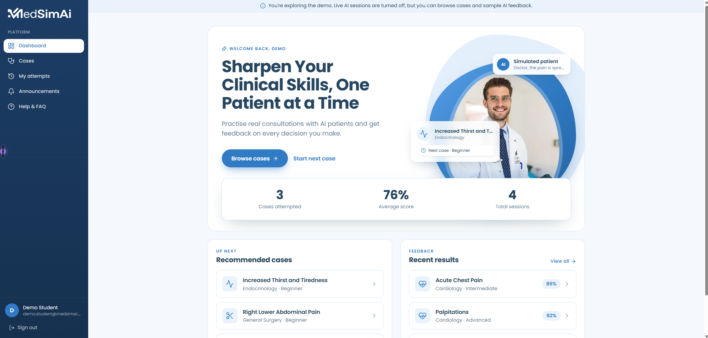
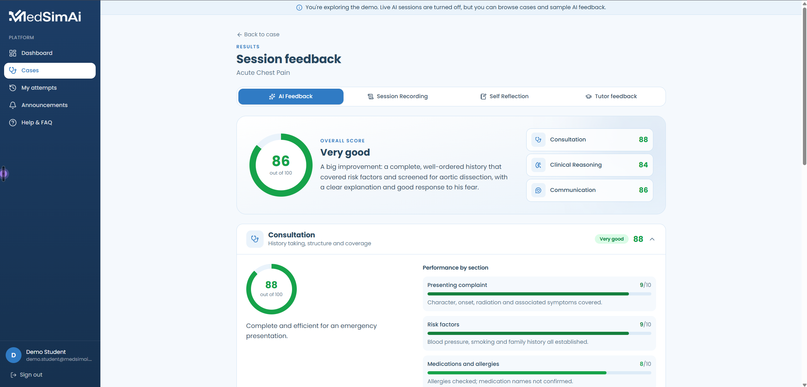
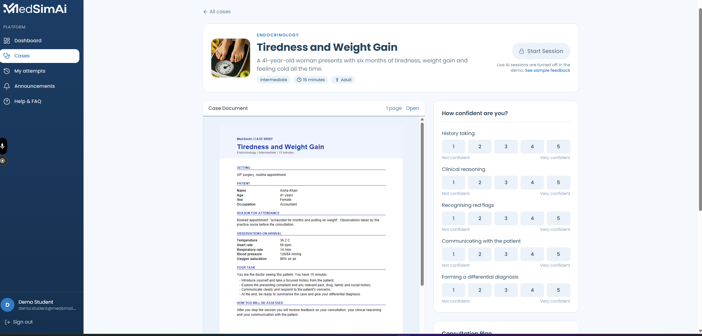

# MedSimAI

**An AI-powered clinical simulation platform where medical students practise patient consultations and get structured, case-specific feedback.**

Students interview an AI patient in a timed, text-based consultation. When they finish, a second AI pass grades the session against the case's hidden clinical data and explains what went well, what was missed, and what to do differently next time.

**[Live demo →](https://med-sim-ai.vercel.app/signin)** (one-click demo accounts, no sign-up needed)



<table>
  <tr>
    <td width="50%"></td>
    <td width="50%"></td>
  </tr>
  <tr>
    <td align="center"><b>AI feedback</b>: scores per category, broken down by section</td>
    <td align="center"><b>Case preparation</b>: case document, confidence ratings and consultation plan</td>
  </tr>
</table>

---

## Try it without signing up

The [sign-in page](https://med-sim-ai.vercel.app/signin) has one-click **demo accounts**:

| Account | What you can do |
| --- | --- |
| **Demo student** | Browse cases, read case documents, write a consultation plan, and open past attempts with full AI feedback. |
| **Demo admin** | Look around the admin CMS (cases, users, announcements, FAQ). It's read-only, and other users' names and emails are masked. |

Live AI sessions are switched off for the demo accounts so public visitors can't use up the AI quota. To try a live consultation, create a free account.

---

## Features

### For students
- **Case library.** Clinical cases across specialties (respiratory, neurology, cardiology, endocrinology, general surgery), each with a difficulty level and duration.
- **Preparation before the session.** Read the case document (an in-app PDF viewer), rate your confidence in five clinical skills, and write a consultation plan.
- **Live AI patient.** A timed chat with a simulated patient who stays in character, uses everyday language, and only gives information when you ask the right questions. A notes panel sits next to the chat.
- **Structured AI feedback** after every session:
  - scores for **Consultation**, **Clinical Reasoning** and **Communication**, each broken down into sections,
  - specific strengths, improvements and the questions you missed,
  - a **plan review** comparing what you planned with what you actually did,
  - a confidence check comparing your self-ratings with your performance.
- **Dashboard and history.** Resume sessions in progress, see recent results, and filter all attempts by case.

### For admins
- **Case CMS.** Create and edit cases, including the hidden AI scenario: patient profile, clinical data, examination findings, diagnosis, expected questions and behaviour rules.
- **User management.** Create accounts, reset passwords, change roles, and delete users along with their data.
- **Content management.** Manage announcements and the FAQ.

---

## Tech stack

| Area | Technology |
| --- | --- |
| Framework | **Next.js 16** (App Router, Server Components, Server Actions), **React 19** |
| Styling | **Tailwind CSS 4**, lucide-react icons |
| Database | **MongoDB** with **Mongoose** |
| Auth | **Auth.js (NextAuth v5)** with credentials, bcrypt password hashing |
| AI | **Google Gemini** via `@google/genai` (structured JSON output) |
| Documents | react-pdf |

---

## Engineering highlights

- **Hidden case data stays on the server.** Each case has a public part and a secret AI scenario (diagnosis, expected questions, hidden history). Student-facing queries select only an allow-listed set of fields ([lib/cases.js](lib/cases.js)), so the answers never reach the browser.
- **Reliable AI output.** Feedback uses Gemini's structured output with a JSON schema, and the server then normalises it: scores are clamped, malformed items are dropped, and the overall score is computed from the category scores so the two can't contradict each other ([lib/feedback.js](lib/feedback.js)).
- **Resilient to quota limits.** Requests fall back through a chain of Gemini models when one is over quota or overloaded, with one delayed retry of the whole chain ([lib/gemini.js](lib/gemini.js)).
- **Prompt-injection aware.** The evaluator prompt treats the student's conversation and plan as data, not instructions, so a student can't talk their way to a higher score.
- **Ownership checks everywhere.** Every attempt lookup is scoped to the signed-in user, and every admin server action re-checks the role from the database, so role changes apply without the user signing in again.
- **Feedback is generated once.** Feedback is created once per attempt and saved with a conditional update, so retries and parallel requests never overwrite it.
- **A safe public demo.** Demo accounts sign in on the server (the password never reaches the browser), the demo admin is read-only, and real users' personal details are masked.
- **Snapshots of preparation.** Each attempt stores a copy of the plan and confidence ratings as they were when it started, so later edits don't change past feedback.

---

## Project structure

```
app/
  (auth)/            Sign-in and sign-up pages
  (home)/            Student app: dashboard, cases, active session, feedback, attempts
  admin-dashboard/   Admin CMS (cases, users, announcements, FAQ)
  api/               Route handlers: AI consultation, attempts, feedback, cases
  actions/           Server actions (auth, sessions, case prep, admin)
lib/                 Data access, AI clients, feedback generation, auth helpers
models/              Mongoose models (User, Case, CaseAttempt, CasePrep, …)
scripts/             Seed and maintenance scripts
proxy.js             Route protection (Next.js 16's replacement for middleware)
```

---

## Running locally

### Prerequisites
- Node.js 20.6 or later (the scripts use `--env-file`)
- A MongoDB database (local, or a free MongoDB Atlas cluster)
- A Google Gemini API key ([Google AI Studio](https://aistudio.google.com/app/apikey))

### 1. Install

```bash
git clone https://github.com/Rejoan2020/MedSimAi.git
cd MedSimAi
npm install
```

### 2. Configure

Create a `.env` file in the project root:

```bash
MONGODB_URI=mongodb+srv://<user>:<password>@<cluster>/medsimai
AUTH_SECRET=<random string>        # generate with: npx auth secret
GEMINI_API_KEY=<your Gemini key>

# Optional: enables the one-click demo accounts (at least 8 characters)
DEMO_PASSWORD=<demo password>
```

### 3. Seed the data

```bash
node --env-file=.env scripts/seed-cases.mjs     # sample clinical cases
node --env-file=.env scripts/seed-content.mjs   # announcements and FAQ
npm run seed:demo                               # demo accounts with sample attempts (needs DEMO_PASSWORD)
```

The seed scripts are safe to re-run. `seed:demo` resets the demo student's history to the sample data.

### 4. Run

```bash
npm run dev
```

Open [http://localhost:3000](http://localhost:3000).

### Creating an admin
The first admin can sign up at `/admin-dashboard/login`. After that, admins are added from the **Users** page. You can also promote an existing account:

```bash
node --env-file=.env scripts/make-admin.mjs you@example.com
```

---

## Scripts

| Command | Description |
| --- | --- |
| `npm run dev` | Start the development server |
| `npm run build` | Build for production |
| `npm start` | Run the production build |
| `npm run lint` | Run ESLint |
| `npm run seed:demo` | Create or reset the demo accounts |

---

## Disclaimer

MedSimAI is an educational project. The AI patients and feedback are for practice only and are not medical advice.
